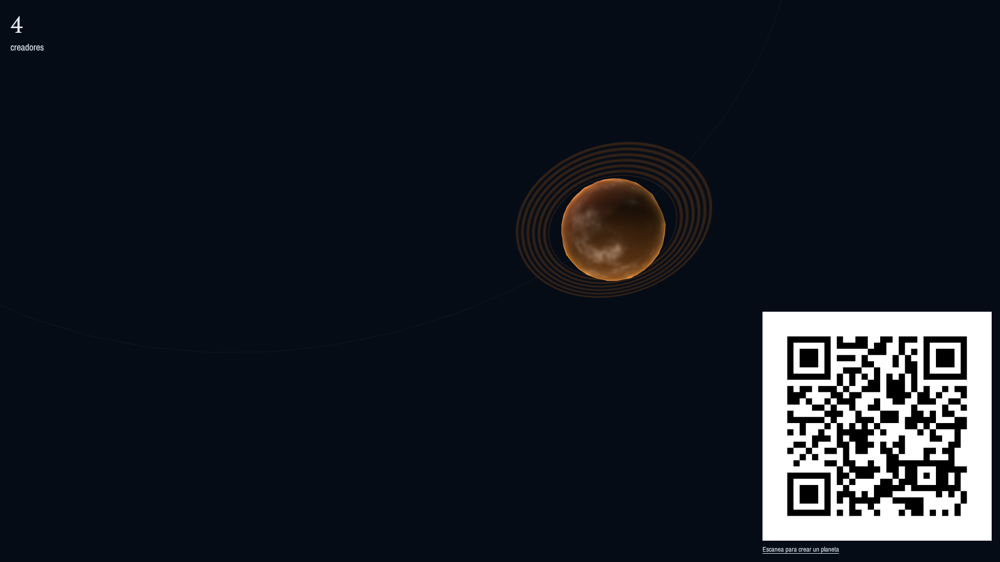
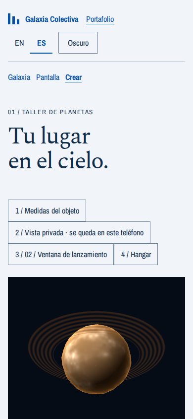
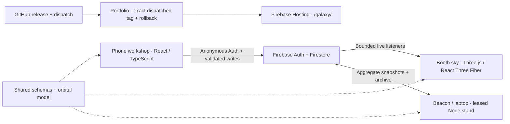

# Collective Galaxy · Galaxia Colectiva

Collective Galaxy (Galaxia Colectiva) is a shared 3D galaxy that visitors build together from their phones, created for USFQ’s BAD Day 2026 fair. Each visitor designs and launches a celestial object into the booth’s live sky, with sound, collective interactions and a personal object record to revisit.

**[Open the galaxy](https://alexanderkholodov.web.app/galaxy/)** ·
**[Create an object](https://alexanderkholodov.web.app/galaxy/create)** ·
**[Booth screen](https://alexanderkholodov.web.app/galaxy/screen)**

## Try it at the fair

1. Open **Create an object** on your phone, or scan the QR on the booth screen. Choose EN or ES and your preferred light/dark appearance.
2. Design a planet, star or moon in the workshop. Inspect it in 3D, then use the launch control or swipe to send it into orbit.
3. Find your object on the shared screen. Edit it live, try the aurora/comet/shooting-star controls when enabled, and tap **Enable sound** to hear it.
4. Open your object record and create a postcard to keep its return link. The hangar retains your earlier objects for relaunch.

Launching and shared interactions require a connection and an open season; the booth operator controls availability. If the fair is closed, you can still explore the workshop and its private preview. A normal browser tab preserves your saved draft when storage is available.

## Views from the application

These are real browser captures from the delivery report’s local rehearsal; they do not certify the live deployment or physical-phone acceptance.





## How it works



The phone and screen share deterministic orbital math and validated schemas. Phones maintain 16 live sky shards atomically with their object writes. Home and Screen listen directly, even with both stands off. A leased stand on Beacon or its laptop backup maintains archives and legacy snapshots without Cloud Functions; the project uses Firebase’s Spark tier. Deny-by-default rules enforce ownership, write budgets and operator switches. Only the portfolio deploys the complete public site.

## Quality evidence

- **458 passing cases on v1.0.1 CI**: 253 unit/script, 180 Firestore/Auth rules and 25 Chromium cases. This is the verified baseline, before the v1.0.2 regressions; see [counts and CI source](docs/delivery/quality-evidence.md).
- **100 simulated concurrent visitors completed** the emulator load journey. Observed operations and modeled fair-day quotas are distinguished in the [quota report](docs/QUOTA-REPORT.md).
- **Five automated failure-mode drills passed**, with their limits and remaining hardware checks in the [drill report](docs/DRILLS.md). Production build swapping exercises A→B→A recovery separately; see [live-safety evidence](docs/live-safety-status.md).
- The release build runs a privacy gate; local automation does not replace [fair-day operator checks](docs/RUNBOOK.md) or real-phone acceptance. The [reduced-motion audit](docs/reduced-motion.md) covers the booth visibility regression.

## Evaluation documents

The delivery documents for the evaluation:

- [Technical report · Informe Little Galaxy](docs/delivery/Informe-Little-Galaxy.pdf)
- [Fair poster · Poster Little Galaxy](docs/delivery/Poster-Little-Galaxy.pdf)
- [Presentation · Presentación Little Galaxy](docs/delivery/Presentacion-Little-Galaxy.pdf)

See the [delivery index](docs/delivery/README.md) for their purpose and current status.

## Resumen en español

**Galaxia Colectiva** es una galaxia 3D que los visitantes construyen juntos desde sus teléfonos para BAD Day 2026 de la USFQ. Abre [Crear](https://alexanderkholodov.web.app/galaxy/create), diseña y lanza tu objeto, búscalo en la pantalla del puesto y conserva su postal. Los lanzamientos requieren conexión y temporada abierta; el taller permite explorar la vista previa cuando la feria está cerrada. La documentación incluye pruebas automatizadas y sus límites; la verificación con teléfonos reales y el montaje del puesto siguen siendo responsabilidad del capitán.

Copyright (c) 2026 Alexander Kholodov. **All rights reserved**; see [LICENSE](LICENSE). Viewing the source on GitHub grants no permission to use, copy, modify or distribute the software or its assets. Third-party licenses remain in force.

## Local development

Install dependencies first with pnpm 11.5.2 and Node 22.18 or newer:

```sh
pnpm install
```

Java 21 is required for `pnpm run test:rules`, which starts the Firestore and Auth emulators.
`pnpm run test` (also `test:unit`) runs the shared admission/store, web integration and release/privacy unit suites.
Install Chromium once with `pnpm exec playwright install chromium` before `pnpm run test:ui`.
The browser runner starts isolated demo emulators, so stop any existing emulator process first. Common commands:

```sh
pnpm --filter @little-galaxy/web run dev
pnpm --filter @little-galaxy/stand run start
# With the stand admin connection configured (demo emulator for local use):
pnpm --filter @little-galaxy/stand control scene bigQr
pnpm --filter @little-galaxy/stand control flag shake off
# Emulator only; requires a fresh output directory (see memory-format.md):
pnpm --filter @little-galaxy/stand freeze-season /absolute/fresh/output-directory
pnpm run typecheck
pnpm run lint
pnpm run test
pnpm run test:live-safety
pnpm run test:rules
pnpm run test:ui
pnpm run test:physics # separate simulation rehearsal, outside PR CI
node scripts/record-screen.mjs --mode demo --url http://127.0.0.1:4177/galaxy/screen?synthetic=50 --duration 15 --output records/
pnpm run build:rehearsal
pnpm run privacy:rehearsal
```

For a write-free development load test, open `/galaxy/screen?synthetic=500&debug=1`. The fps readout is dev-only or enabled explicitly by `?debug=1`;
production ignores synthetic fixtures. Current review-fix evidence, software fps and phone first-load
weights are in [the review-fix handoff](docs/confirmed-review-fixes.md). The booth laptop and real-phone
hangar acceptance remain unmeasured. The phone shows an immediate specimen; its 3D inspector loads
only when opened.

Open `/galaxy/`. Routes also include `/galaxy/screen`, `/galaxy/create`, `/galaxy/talk` and
`/galaxy/o/:id` (only talk retains its foundation stub). English is the
default; `?lang=es` overrides the saved preference. Language and
appearance are saved when browser storage permits. The reference sky always stays dark.

The portfolio provides `/profile.json` and `/tokens.css` at runtime. Missing files do not prevent use.
The profile parser accepts `{ name, links: [{ href, label: { en, es } }] }`, with optional `nav` and
`socials` arrays of the same link shape. Plain string labels are also accepted. Invalid links are
discarded; no profile name or social account is invented. Local CSS supplies complete fallback tokens.

### Firebase web configuration

The six public Vite variables are documented with rehearsal placeholders in `apps/web/.env.example`:

- `VITE_FIREBASE_API_KEY`
- `VITE_FIREBASE_AUTH_DOMAIN`
- `VITE_FIREBASE_PROJECT_ID`
- `VITE_FIREBASE_STORAGE_BUCKET`
- `VITE_FIREBASE_MESSAGING_SENDER_ID`
- `VITE_FIREBASE_APP_ID`

GitHub builds read the same names from repository variables (`vars.*`), not secrets. A production build
fails if any value is absent or empty. `pnpm run build:rehearsal` loads the committed placeholders; use
`pnpm run build` when the real values are in the environment or Vite's
`apps/web/.env*` production files. The privacy gate uses the same production-file
precedence and process-environment overrides as the default Vite build.

Emulator mode is development-only. Start local Firebase services against the isolated demo project:

```sh
pnpm exec firebase emulators:start --only firestore,auth --project demo-little-galaxy
```

With the emulators running, open the synthetic season and optionally start the snapshot writer:

```sh
FIRESTORE_EMULATOR_HOST=127.0.0.1:8080 FIREBASE_PROJECT_ID=demo-little-galaxy pnpm run demo:seed
FIRESTORE_EMULATOR_HOST=127.0.0.1:8080 FIREBASE_PROJECT_ID=demo-little-galaxy pnpm --filter @little-galaxy/stand start
```

`demo:seed` refuses any other host/project and never loads a credential. A missing or closed
`config/live` denies launches; the stand does not automatically open a real season.

Set `VITE_USE_EMULATORS=1` in the web development process before starting Vite. The application then
uses project `demo-little-galaxy`; production builds reject `VITE_USE_EMULATORS` whenever it is set.
Vite, preview and the default emulators bind to loopback. For an intentional phone test on a trusted
LAN, start the emulator configuration and web server with these explicit opt-ins instead:

```sh
pnpm run emulators:lan
VITE_USE_EMULATORS=1 pnpm --filter @little-galaxy/web run dev:lan
```

`firebase.lan.json` changes only the Auth/Firestore listener hosts to `0.0.0.0`; it retains the demo
project selected by the script, the checked-in rules and ports 8080/9099. Both SDKs use the page hostname,
so a phone can reach the laptop through its LAN address. Stop both processes after the test. Rules
tests use the loopback configuration and isolated demo project, start Firestore and Auth, and do not
access live data. Run rules and browser commands sequentially locally; CI gives each its own runner.

The stand starts without credentials. If `GOOGLE_APPLICATION_CREDENTIALS` is set, firebase-admin uses
that file through application-default credentials and requires `FIREBASE_PROJECT_ID` to be exported.
Use the exact data-project ID from `VITE_FIREBASE_PROJECT_ID`, not an assumed display name. The rules
release job reads that same repository variable and fails closed if it is missing.
Keep the credential file outside public source and output; never put
key contents in an environment variable or browser config.
The stand also schedules ambient meteor events (default 6–15 minutes, only when `seasonOpen` and
`meteorShowers` are true). Its `control` command updates scenes, timing and kill switches through
the admin SDK; clients cannot write config. See the v0.5.0 handoff for the allowlisted commands.
The elected stand (admin-only `leases/stand`, 30-second heartbeat / 90-second expiry) writes `snapshots/live` after its first active-object read and every 30 seconds,
using one cached listener rather than rescanning the galaxy. That legacy snapshot is not used by the live home or screen. See [live sky design](docs/live-sky.md) and [Beacon setup and migration](docs/RUNBOOK.md#11-alpha1-live-sky-beacon-and-automatic-laptop-backup). It handles SIGINT/SIGTERM cleanup.
In emulator mode it refuses non-`demo-` project IDs and does not load credentials.

## Build and delivery

`apps/web/dist` is the release payload: unpack its contents under the portfolio's `dist/little-galaxy/`.
The payload includes the fonts' OFL notices and the QR/audio dependencies' license notices in `licenses/`.
Vite fixes asset URLs to `/little-galaxy/`. Generated `version.json` contains `version`, `commit` (nullable
outside a git checkout), and `builtAt` (UTC ISO timestamp). Build caching is disabled so this metadata
describes that invocation.

`.github/workflows/checks.yml` runs three independent PR jobs with the pnpm cache: unit tests + lint +
typecheck + build/privacy, current-model Firestore rules, and one real browser player journey. The emulator
and Chromium binaries are cached too. The target is about five minutes including a same-repository PR
preview; cold downloads or runner queues can take longer. Superseded PR runs are cancelled. Merges build
the exact release commit without repeating the PR test suite.

`pnpm run test:rules` runs only `galaxies.test.js` and `deny-all.test.js`: ownership, reciprocal
admission, immutable history, lifecycle/keeper permissions and catch-all denial. `pnpm run test:ui`
checks welcome, name, two launches, a fresh browser reading both, background freeze/resume, phone
layout in light/dark themes, Google keeper refusal/acceptance, and booth selection with its join QR. It waits for accepted state, not fixed delays. The retired users/objects/events,
stand enrichment, load/drill and quota-probe suites are removed. Current stand release migrations,
emergency controls, privacy and publication safeguards retain their fast regression tests.

`pnpm run test:physics` remains available separately; another worker owns its simulation contract.
`pnpm run test:live-safety` is an explicit build-swap rehearsal, outside default PR checks. Run it
when changing version/chunk recovery, then verify a deployed preview and actual phones. Browser freeze
simulation and a phone-sized viewport do not certify hardware behavior.

Shipping merges choose their version from the PR head branch's leading `v1.0.0-alpha.N[.M...]`
(or the title if the branch has no version). A free requested tag releases exactly as named:
`v1.0.0-alpha.9-close` releases alpha.9. Repeated merges of that milestone use alpha.9.1, then
alpha.9.2. An unversioned merge continues below the newest active tag (alpha.8 → alpha.8.1).
An older milestone falls back below the newest tag and says so in the PR forecast. Every newly
allocated version sorts above reserved active alpha releases using numeric semver precedence;
historical stable tags do not override the current alpha line.

Nobody edits a package version, counter or release label. **This merge can reach production** shows
the forecast and its reason in the PR check summary. Main resolves the merged PR, refreshes tags and
recalculates before reserving the exact-commit tag, retrying concurrent collisions. Existing tags on
the same commit resume the release. Require this check and the three check jobs in branch protection.
Docs-only merges explicitly skip. The shipping filter covers web/shared/stand code, database
rules/indexes/config, dependencies and build/release tooling. See
[automatic releases](docs/automatic-releases.md) for the hierarchy, sibling-fix rules and receiver contract.

On Windows the rules, UI and live-safety runners keep an emulator owner alive until the suite ends,
then stop its full process tree with `taskkill /PID <pid> /T /F`, including after errors or Ctrl+C.
POSIX keeps Firebase's `emulators:exec` lifecycle. Occupied emulator ports fail before startup;
Windows also requires the local hub port 4400 to be free.

The checked build is uploaded as `galaxy-dist`. Same-repository PRs pass it to a separate `preview`
environment job, which never checks out or executes PR code and deploys only the expiring `pr-<number>`
channel. Missing preview credentials produce a notice; fork PRs never enter that job. For an optional
read-only hosted smoke, set `BASE_URL` to the deployed origin and run `pnpm run test:ui`; it blocks
identity creation and writes.

On merge, the automatic version becomes an exact-commit tag. An existing tag on the same commit
resumes the release; it never silently skips shipping changes. The guard verifies the automatic
numeric milestone line, main first-parent history and increasing version precedence. The build passes `RELEASE_TAG` through Turbo into Vite to
stamp the runtime and `version.json`, independently of package.json. It builds with the production
public config and privacy gate, packs `galaxy-dist-<tag>.tar.gz`, and attaches `version.json` and
`SHA256SUMS`. The `little-galaxy-rules` environment deploys rules and indexes with the current galaxy migration and season
restoration directly after the merge: it only restricts deployment to `main` and `v*` tags and has no manual
reviewer (owner decision 2026-10-27). No PR tests run again during release.

After the rules are live, publication verifies existing assets on retry and dispatches `galaxy-release`
with the exact tag to the portfolio using `PORTFOLIO_DISPATCH_TOKEN`. The final release step polls
`https://alexanderkholodov.web.app/little-galaxy/version.json` with cache bypass, every five seconds
for at most eight minutes. Only the exact released commit and stamped version succeed; HTTP errors,
stale metadata and missing dispatch/deployment fail with **RELEASE NOT LIVE** and a recovery message.
Only the portfolio deploys production Hosting and performs Hosting rollback; see the
[release/rollback runbook](docs/RUNBOOK.md#7-emergency-rollback-procedure).

The privacy gate is part of `pnpm run build`. It scans every output file, gunzips `.gz` output, decodes
long base64 and base64url runs, allows only the configured public Firebase API key, rejects known private
key/service-account/token markers and `private` path references, and compares output with source files
under `private/` directories when those files are at least 32 bytes. It fails closed for missing or empty
output, symbolic links, malformed gzip files and scan errors. It does not recognize every possible secret
or encoding (for example arbitrary hex, URL encoding or Brotli), and it does not prove that an otherwise
public Firebase configuration is correctly secured. It is a release safeguard, not a substitute for
review and Firebase security rules.

## Design decisions

The design artifact is an observatory finding chart. Spectral 400 is the display face; Archivo Narrow
400 and 700 handle text and labels. Both are self-hosted from the supplied WOFF2 files under the SIL Open
Font License 1.1, with Georgia and Trebuchet MS as later fallbacks. The interface keeps a dark reference
field, printed-chart typography and compact marginal annotations while preserving light and dark UI chrome.

Preview and real-phone verification are required before claiming deployed behavior. The workshop saves its validated draft and design/edit mode continuously and recovers its own inventory
after reload. Active-object edits appear live; launching another object archives the previous one, and
hangar relaunches reassemble it. Both count toward the rules-enforced five launches/relaunches per UTC day.
Moons can orbit your own planets or operator-seeded unclaimed planets; details are in the v0.3.0 handoff.
Live-safe deploy resilience, chunk-load recovery, and automated verification belong to G v0.7.0.
Fair-day operational readiness, 100-phone load testing, failure-mode drills, runbook, booth screen kiosk presentation, and backup video recording belong to G v1.0.0. Physical booth laptop rehearsal and real-phone acceptance remain captain work.

## License

Copyright (c) 2026 Alexander Kholodov. All rights reserved.
No permission is granted to use, copy, modify or distribute the software or its assets
except viewing the source on GitHub. See [LICENSE](LICENSE). Third-party components
retain their own licenses, including the fonts’ OFL notices.
